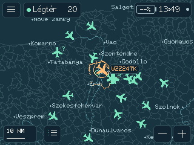
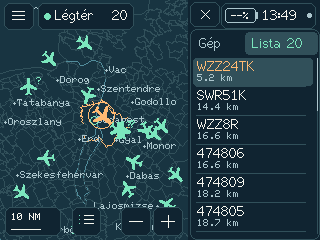
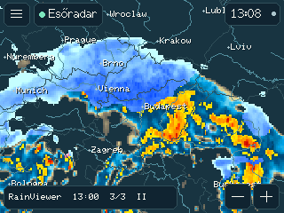
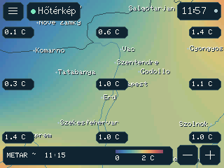

# FlightDeck for LilyGO T-Deck

**[Magyar útmutató](README.hu.md)** · [Hardware and schematics](docs/hardware.md) · [Map data and credits](maps/README.md)

See which town an aircraft is flying over. FlightDeck turns the 320 × 240 display of a LilyGO T-Deck into a flight map with aircraft details, animated rain radar and a temperature map. Aircraft positions come from ADS-B reports over Wi-Fi. An optional GPS sets the map centre as you travel.

| Airspace around Budapest | Nearby flights, sorted by distance |
|:---:|:---:|
|  |  |
| **Rain radar over Central Europe** | **Surface air temperature** |
|  |  |

These are captures from a T-Deck using the public Budapest map centre. The screens shown are in Hungarian. Select **Beállítások → Nyelv → English** for the English interface.

## What you need

- The original **LilyGO T-Deck**, ESP32-S3, 16 MB flash, 8 MB OPI PSRAM, and a USB data cable. The firmware targets the main ESP32-S3. The keyboard has its own controller.
- A **2.4 GHz Wi-Fi network** for live flights and weather. The built-in maps cover Hungary in detail and Central Europe at wider weather zoom levels.
- **GPS, external I²C environmental sensors and microSD are optional.** Without a GPS fix the map uses the coordinates in Settings. The default is central Budapest. Missing sensor readings appear as `--`. Without a usable card the map loads from flash.

## Install or update

The [installation folder](install/) contains two ready-to-flash images. The commands below are for Windows PowerShell. Install Python 3 with the Windows launcher, then open a terminal in a clone or an extracted [project ZIP](https://github.com/janix12/T-Deck-FlightDeck/archive/refs/heads/main.zip).

1. Close any serial monitor. Connect the T-Deck and switch it on. In Windows Device Manager, look under **Ports (COM & LPT)** for the port that appears when you connect it. Replace the example `COM5` below with yours. Install the flashing tool and set the port variable.

   ```powershell
   py -m pip install "esptool==4.8.1"
   $port = 'COM5'
   ```

2. **Before replacing another firmware**, save your current flash if you want to restore it later. This backup can contain Wi-Fi credentials and device settings. Keep it private. To enter download mode, hold the centre of the trackball, press and release **RST**, then release the trackball. Check the port again if Windows assigns a different number.

   ```powershell
   New-Item -ItemType Directory -Force backup | Out-Null
   py -m esptool --chip esp32s3 --port $port --before no_reset read_flash 0x0 0x1000000 backup/original-16MB.bin
   ```

3. Enter download mode again. For a **first installation**, write the full image at **0x0**. This replaces the bootloader, partition table, application and settings in the covered area.

   ```powershell
   py -m esptool --chip esp32s3 --port $port --before no_reset write_flash 0x0 install/FlightDeck-full.bin
   ```

   For an **update to an existing FlightDeck with the same partition layout**, use this command instead. It preserves saved settings.

   ```powershell
   py -m esptool --chip esp32s3 --port $port --before no_reset write_flash 0x10000 install/FlightDeck.ino.bin
   ```

4. Wait for the hash verification, then press **RST** to start FlightDeck. To restore your own full backup later, enter download mode and use the first-install command with `backup/original-16MB.bin` at `0x0`. You can check the downloads with `Get-FileHash install/*.bin -Algorithm SHA256` against [the published checksums](install/SHA256SUMS.txt).

## First start

1. Open **Settings** (key **3**). Enter your Wi-Fi name and password. You can scan for networks in the name field. For an open network, save an empty password. Tap **Save** at the lower left or **Cancel** at the lower right.
2. Set latitude and longitude in decimal degrees if you use the device without GPS. Choose `Budapest`, `UTC` or a POSIX time zone. Wi-Fi synchronises the clock using NTP. A valid GPS date and time can initialise it too. Manual UTC entry uses `YYYY-MM-DD HH:MM`.
3. Open **Airspace** (key **1**). Defaults are a 40 nautical mile radius and a 30-second refresh. Tap an aircraft to see its callsign, altitude, speed and location. If a refresh fails, the screen shows the age of the last data.

## Controls

| Action | How |
|---|---|
| Open the menu | Tap **☰** or press **M**. Keys **1–5** open Airspace, Instruments, Settings, Rain radar and Heat map. |
| Zoom or inspect a flight | Tap **+ / −** or press **I / O**. Open the list with the lower-left list icon. Tap it again, tap **×**, or press **F** to return to the full map. Swipe the side card to scroll. |
| Read aircraft symbols | A filled plane has a position at most 90 seconds old. An outline marks an older position. A **?** means the heading is unknown. States marked **\*** are estimates from movement. |
| Read the weather | RainViewer supplies up to three recent frames. Tap the bottom time label to pause or resume. The heat map uses nine Open-Meteo samples or nearby METAR airport observations. Both weather views refresh about every ten minutes. |
| Check hardware | Open **Instruments** (key **2**). Press **B** to test the speaker or **R** to retry mounting the card. The battery icon shows estimated charge on battery power or **USB** on detected external power. The blue LED indicates charging. |
| Change appearance | On the last Settings page, select a language, theme and sleep delay. The default is 30 minutes. Enter **0** to disable sleep. A touch or key wakes the screen. |

## Build from source

Install Git for Windows and open PowerShell in the project folder. The first command downloads Arduino CLI, ESP32 Arduino core 2.0.17, the pinned LilyGO drivers and the sensor libraries. The second command rebuilds with those tools already installed.

```powershell
.\build.ps1 -Setup
.\build.ps1
```

Your new images are in `firmware/`. Use those paths in the flashing commands to install your own build. The map packs in `maps/` are included at build time. Regeneration is optional. [Map sources and regeneration](maps/README.md)

## Troubleshooting and privacy

- **No flights or weather:** check Wi-Fi and the clock in Instruments. The device requires a valid date for HTTPS. Confirm your manual map centre if GPS has no fix.
- **No GPS data:** connect a 3.3 V UART module's TX to the configured T-Deck RX and share ground. GPIO44 is the default, GPIO43 is selectable. Baud rate **0** tries supported rates automatically.
- **SD error:** reinsert the card and press **R** in Instruments. The firmware verifies the base map when loading it. Optional minute-by-minute environmental logging requires a writable card and **SD logging = 1**.
- **Serial diagnostics:** use 115200 baud. Send `?` for status, `X` for the input and hardware test, `Y` for its counters, and `E` to exit the test.
- Wi-Fi settings stay on the device. Online flight and weather queries send the selected map centre or surrounding area to their providers. Keep flash backups, serial logs and SD logs private. [adsb.lol](https://api.adsb.lol/docs) · [RainViewer](https://www.rainviewer.com/api/weather-maps-api.html) · [Open-Meteo](https://open-meteo.com/en/docs) · [Aviation Weather Center](https://aviationweather.gov/data/api/)

[Hardware documentation](docs/hardware.md) · [Data, artwork and third-party notices](maps/README.md)
