# FlightDeck for LilyGO T-Deck

**[Open the USB installer →](https://janix12.github.io/T-Deck-FlightDeck/?lang=en)** · [Firmware downloads and manual installation](https://github.com/janix12/T-Deck-FlightDeck/releases/latest)

Open the installer in desktop Chrome or Edge and connect your original T-Deck with a USB data cable. Choose **First installation** for a new device or to replace another system. If it already runs FlightDeck, choose **Update FlightDeck** to keep your settings. Click **Connect and install** and select the device’s USB port.

The **Firmware version** list selects the latest release by default. To restore an older version over USB, choose it, keep **Update FlightDeck** selected to preserve settings, then click **Connect and install**. **First installation** also installs the selected version and replaces the previous settings.

**[Magyar útmutató](README.hu.md)** · [Hardware and schematics](docs/hardware.md) · [Map data and credits](maps/README.md)

See which town an aircraft is flying over. FlightDeck turns the 320 × 240 display of a LilyGO T-Deck into a flight map with aircraft details, animated rain radar and a temperature map. Aircraft positions come from ADS-B reports over Wi-Fi. An optional GPS sets the map centre as you travel.

| Live traffic · 29 aircraft around Budapest | Aircraft list · DLH6CH selected |
|:---:|:---:|
| 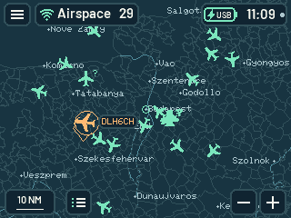 | 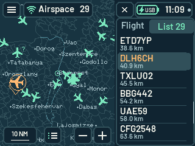 |
| **Follow and Solo aircraft** | **Tracking DLH6CH on the full map** |
| 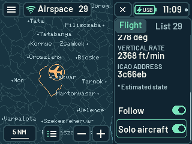 | 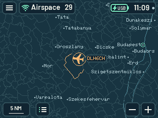 |
| **Rain radar over Central Europe** | **Surface air temperature** |
| 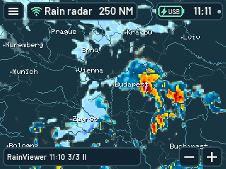 | 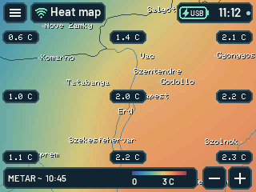 |
| **Instruments · v1.4.0** | **Settings · v1.4.0** |
| 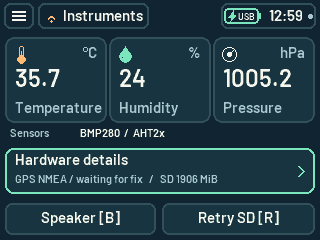 | 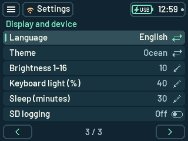 |

The traffic and weather screens were captured on v1.3.1. The Instruments and Settings screens were captured on v1.4.0. The three waves beside the page title show an active Wi-Fi connection. The radar recorded 29 aircraft in one live ADS-B update, with DLH6CH selected for tracking. Choose **Beállítások → Nyelv → English** for the English interface. [Earlier example of the API limit notice](docs/images/airspace.png)

| Using the trackball | Using the touchscreen |
|:---:|:---:|
| 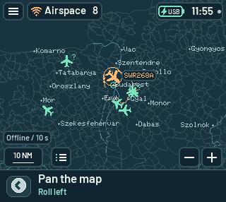 | 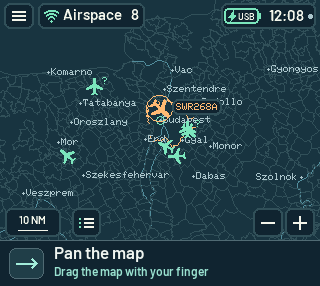 |
| Roll the ball to pan. Press to open the list, scroll to a flight, then press again for details. | Drag the map, then tap **+** to zoom in. Tap the **Airspace** title to centre the map again at the same zoom level. |

These T-Deck recordings replay an earlier traffic sample from Budapest.

**Follow a single aircraft**

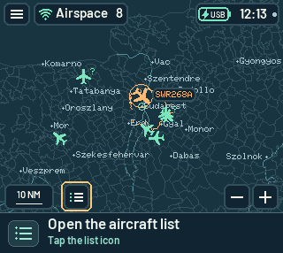

Turn on **Solo aircraft** at the bottom of the flight details. This also turns on **Follow**. Tap **×** to return to the full map. The GIF shows DEMO101 flying an accelerated, simulated track.

**Rain radar around Budapest**

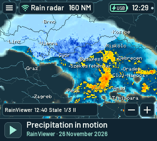

The archived RainViewer images span 12:40 to 13:00 Budapest time on 26 November 2026. Tap **+** to zoom in. Tap the timestamp at the bottom left to pause playback, and tap it again to resume.

### Temperature map around Budapest

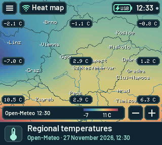

The labels show modelled air temperatures two metres above the ground. Tap **+** to zoom in. The colour scale at the bottom adjusts to each view. The recording uses data for 12:30 Budapest time on 27 November 2026. [Data from Open-Meteo](https://open-meteo.com/)

### Instruments

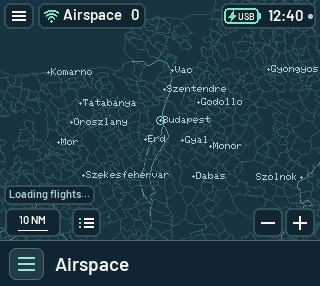

Open **☰ → Instruments** to see separate cards for temperature (°C), relative humidity (%) and air pressure (hPa). Choose **Hardware details** for device and network status. [The v1.4.0 main menu](docs/images/v140-menu-en.png)

**Settings** has three pages: **Network and system**, **Map and GPS**, and **Display and device**. A chevron opens a submenu, a pencil edits a value, two arrows cycle through options, and a switch turns a feature on or off.

### Screen saver

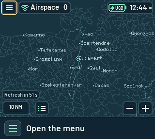

Tap **☰** in the top left and choose **Sleep now**. When the clock appears, tap anywhere on the display once to return to the previous screen.


The top bar shows three arcs when connected, a crossed-out icon when offline, and a circular arrow while reconnecting. The animation uses frames captured on a T-Deck.

## What you need

- The original **LilyGO T-Deck**, ESP32-S3, 16 MB flash, 8 MB OPI PSRAM, and a USB data cable. The firmware targets the main ESP32-S3. The keyboard has its own controller.
- A **2.4 GHz Wi-Fi network** for live flights and weather. The built-in maps cover Hungary in detail and Central Europe at wider weather zoom levels.
- **GPS, external I²C environmental sensors and microSD are optional.** Without a GPS fix the map uses the coordinates in Settings. The default is central Budapest. Missing sensor readings appear as `--`. Without a usable card the map loads from flash.

## Install or update

The [installation folder](install/) contains two ready-to-flash images. The commands below are for Windows PowerShell. Install Python 3 with the Windows launcher, then open a terminal in a clone or an extracted [project ZIP](https://github.com/janix12/T-Deck-FlightDeck/archive/refs/heads/main.zip).

1. Close any serial monitor. Connect the T-Deck and switch it on. In Windows Device Manager, look under **Ports (COM & LPT)** for the port that appears when you connect it. Replace the example `COM5` below with yours. Install the flashing tool and set the port variable.

   ```powershell
   py -m pip install "esptool==4.8.1"
   $port = 'COM5'
   ```

2. **Before replacing another firmware**, save your current flash if you want to restore it later. This backup can contain Wi-Fi credentials and device settings. Keep it private. To enter download mode, hold the centre of the trackball, press and release **RST**, then release the trackball. Check the port again if Windows assigns a different number.

   ```powershell
   New-Item -ItemType Directory -Force backup | Out-Null
   py -m esptool --chip esp32s3 --port $port --before no_reset read_flash 0x0 0x1000000 backup/original-16MB.bin
   ```

3. Enter download mode again. For a **first installation**, write the full image at **0x0**. This replaces the bootloader, partition table, application and settings in the covered area.

   ```powershell
   py -m esptool --chip esp32s3 --port $port --before no_reset write_flash 0x0 install/FlightDeck-full.bin
   ```

   For an **update to an existing FlightDeck with the same partition layout**, use this command instead. It preserves saved settings.

   ```powershell
   py -m esptool --chip esp32s3 --port $port --before no_reset --after no_reset write_flash 0x10000 install/FlightDeck.ino.bin
   if ($LASTEXITCODE -eq 0) { py -m esptool --chip esp32s3 --port $port --before no_reset erase_region 0xe000 0x2000 }
   ```

4. Wait for the hash verification, then press **RST** to start FlightDeck. To restore your own full backup later, enter download mode and use the first-install command with `backup/original-16MB.bin` at `0x0`. You can check the downloads with `Get-FileHash install/*.bin -Algorithm SHA256` against [the published checksums](install/SHA256SUMS.txt).

## First start

1. Open **Settings → Wi-Fi name → Scan networks**. For a protected network, enter the password when prompted and tap **Save**. For an open network, save the name. On a mesh network, select the shared name that also broadcasts on 2.4 GHz. **Instruments → Hardware details** shows authentication failures and whether the device is waiting for an IP address.
2. Set latitude and longitude in decimal degrees if you use the device without GPS. Choose `Budapest`, `UTC` or a POSIX time zone. Wi-Fi synchronises the clock using NTP. A valid GPS date and time can initialise it too. Manual UTC entry uses `YYYY-MM-DD HH:MM`.
3. Open **Airspace** (key **1**). Defaults are a 40 nautical mile radius and a two-minute refresh. Tap an aircraft to see its callsign, altitude, speed and location.

## Saved Wi-Fi networks and firmware updates

Open **Settings → Saved networks** to browse up to eight profiles. **Add network** scans for nearby networks. Select a saved name to connect or forget it. Forgetting a network requires confirmation. Upgrading imports the previously saved network. After a lost connection FlightDeck looks for available saved networks and uses their stored credentials.

Version 1.1.0 is the first release with Wi-Fi updates. Install it once over USB. **Settings → Firmware update** shows the installed version. Once Wi-Fi and the clock are ready, FlightDeck checks at startup and once a day. When an update is available, **FW+** alternates with the clock. Tap it to open the update screen and choose **Install**. The device downloads the application over HTTPS from the project’s GitHub Pages site, writes it to the other application slot, verifies its SHA-256 digest and restarts. Your networks and settings are preserved.

From v1.2.0, open **Settings → Firmware update → Previous versions** to see up to five releases preceding the installed version. The first Wi-Fi release, v1.1.0, is always included. Select a version, review the installed and selected version numbers, then tap **Restore**. FlightDeck downloads and verifies the original release over Wi-Fi. After restoring v1.1.x, use **Check → Install** to return to the latest release. [Version list on the T-Deck](docs/images/firmware-versions.png)

## Why does the flight map refresh every two minutes?

Without an API key, adsb.lol allows **500 requests per day per public IP address**. Devices sharing an internet connection share this allowance. The provider resets its daily counter at **00:00 UTC**. [Official adsb.lol API limits](https://www.adsb.lol/docs/open-data/api)

Starting with v1.0.2, FlightDeck requests flight data every **120 seconds** by default. This uses at most **480 requests in 16 hours** of continuous Airspace use. Select an interval from 120 to 300 seconds in **Settings → Refresh (sec)**. Upgrading raises older, shorter intervals to 120 seconds. The device pauses new flight requests on other pages and while the screen saver is active.

**Instruments → Hardware details** shows this device’s daily request count, which survives a restart. If the server returns **HTTP 429**, the radar shows **API limit** and the next attempt in local time. FlightDeck honours the provider’s `Retry-After` header and backs off progressively if the header is missing. Weather layers use separate providers.

The device reconnects after losing Wi-Fi. When the signal stays weak, it looks for an access point on the same network name and security mode with a signal at least 10 dB stronger. Roaming preserves the flight request schedule.

## Controls

| Action | How |
|---|---|
| Open the menu | Tap **☰** or press **M**. Keys **1–5** open Airspace, Instruments, Settings, Rain radar and Heat map. |
| Leave the menu open | The menu closes 60 seconds after the last touch, keypress or trackball input. While it is open, new aircraft requests, weather requests and automatic firmware checks pause. |
| Zoom or inspect a flight | Tap **+ / −** or press **I / O**. Open the list with the lower-left list icon. Tap it again, tap **×**, or press **F** to return to the full map. Swipe the side card to scroll. |
| Pan the map | Drag with a finger on the Airspace, Rain radar or Heat map. Roll the trackball in any of four directions to look around. Tap the page title to return to your location, or to the aircraft if following a flight. |
| Lists and centre click | Press the trackball on the full Airspace map to open the aircraft list. Roll up or down to move the highlight, then press the ball to open the aircraft details. Use the same controls to select items in menus and settings lists. |
| Follow a flight | Select an aircraft from the list, scroll to the bottom of its details and turn on **Follow**. The map zooms in and centers on each new position. If the signal is lost, the last known position stays visible. The device looks for the aircraft again at the normal refresh interval. |
| Solo aircraft | Turning this on starts following the selected aircraft and hides other aircraft icons. Turn it off to show other aircraft again while continuing to follow. You can also turn Follow off separately. Selecting another aircraft clears both switches. |
| Wi-Fi in the top bar | Three steady waves indicate a Wi-Fi connection with an IP address. The waves build up while connecting. A circular arrow indicates a retry. A crossed-out Wi-Fi symbol means disconnected or unconfigured. |
| Read aircraft symbols | A filled plane has a position at most 90 seconds old. An outline marks an older position. A **?** means the heading is unknown. States marked **\*** are estimates from movement. |
| Read the weather | RainViewer supplies up to three recent frames. Tap the bottom time label to pause or resume. The heat map uses nine Open-Meteo samples or nearby METAR airport observations. Both weather views refresh about every ten minutes. |
| Check hardware | Open **Instruments** (key **2**). Press **B** to test the speaker or **R** to retry mounting the card. The battery icon shows estimated charge on battery power or **USB** on detected external power. The blue LED indicates charging. |
| Numbers and symbols | Tap **SYM** on screen while editing. On a newer matrix-mode keyboard, press the physical **SYM** key to toggle. On older keyboards, hold **SYM** and press **Q**. Repeat to switch back. With **SYM ON**, **W E R** type **1 2 3**, **Space** types **0**, and **Q** types **#**. The separate on-screen **0** button works in either mode. |
| Keyboard lighting | On older keyboards, hold **ALT** and press **B** to turn the light on or off. It can stay lit while the screen saver is active. On newer controllers, adjust the brightness under **Settings → Keyboard light (%)**. |
| Change appearance | On the last Settings page, select a language, theme and sleep delay. The default is 30 minutes. Enter **0** to disable sleep. A touch or key wakes the screen. |

## Build from source

Install Git for Windows and open PowerShell in the project folder. The first command downloads Arduino CLI, ESP32 Arduino core 2.0.17, the pinned LilyGO drivers and the sensor libraries. The second command rebuilds with those tools already installed.

```powershell
.\build.ps1 -Setup
.\build.ps1
```

Your new images are in `firmware/`. Use those paths in the flashing commands to install your own build. The map packs in `maps/` are included at build time. Regeneration is optional. [Map sources and regeneration](maps/README.md)

To prepare a release, fetch tags (`git fetch --tags`), set the new version in `FlightDeck/firmware_version.h`, then run `py tools/prepare_rollback.py` before building. Publish the generated catalog and `install/archive/` files with the firmware. Older devices use the same permanent archive URLs. After packaging the new binaries, manifest.json and SHA256SUMS.txt in the install directory, run `py tools/prepare_rollback.py --usb`. Publish the resulting `install/usb-releases.json` and the archived full images as well.

## Troubleshooting and privacy

- **No flights or weather:** check Wi-Fi and the clock in Instruments → Hardware details. The device requires a valid date for HTTPS. Confirm your manual map centre if GPS has no fix.
- **No GPS data:** connect a 3.3 V UART module's TX to the configured T-Deck RX and share ground. GPIO44 is the default, GPIO43 is selectable. Baud rate **0** tries supported rates automatically.
- **SD error:** reinsert the card and press **R** in Instruments. The firmware verifies the base map when loading it. Optional minute-by-minute environmental logging requires a writable card and **SD logging** switched on.
- **Serial diagnostics:** use 115200 baud. Send `?` for status, `X` for the input and hardware test, `Y` for its counters, and `E` to exit the test.
- Wi-Fi settings stay on the device. Online flight and weather queries send the selected map centre or surrounding area to their providers. Keep flash backups, serial logs and SD logs private. [adsb.lol](https://api.adsb.lol/docs) · [RainViewer](https://www.rainviewer.com/api/weather-maps-api.html) · [Open-Meteo](https://open-meteo.com/en/docs) · [Aviation Weather Center](https://aviationweather.gov/data/api/)

[Hardware documentation](docs/hardware.md) · [Data, artwork and third-party notices](maps/README.md)
